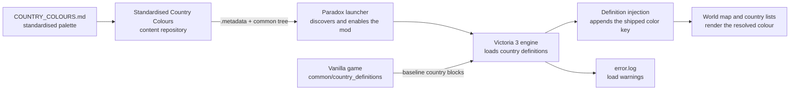
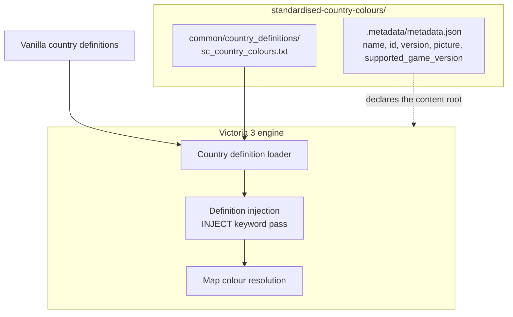
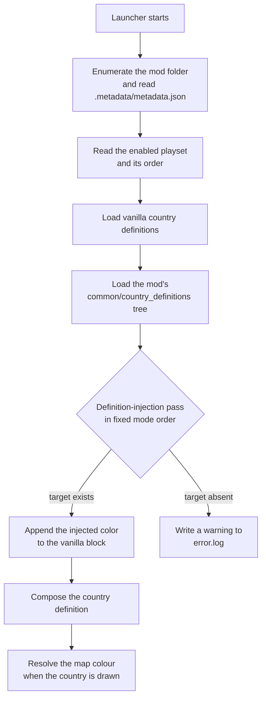
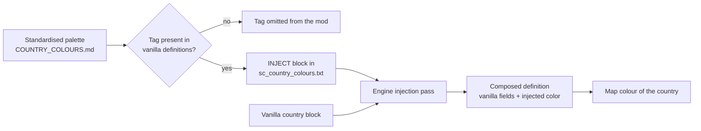
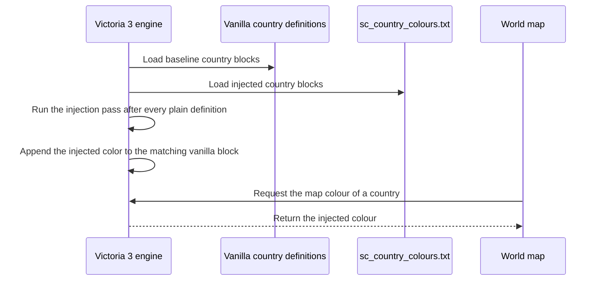
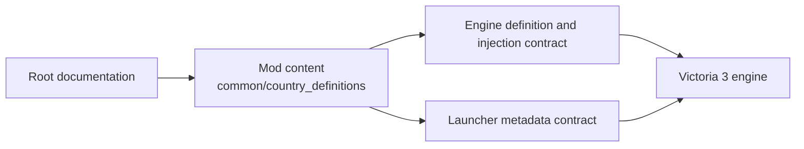

# Standardised Country Colours Architecture

This document describes the verified current architecture of the Victoria 3 edition of Standardised Country Colours, a cross-game project that assigns consistent, historically inspired map colours to selectable countries in various grand strategy games. Each edition is a content-only definition package for one game; this one targets Victoria 3, whose entire behaviour is produced by the game engine's country-definition loading and definition-injection contract. It documents the shipped override file, the palette it encodes, and the constraints that govern any change to that content.

## 📑 Table of Contents

- [Purpose](#purpose)
- [System Context](#system-context)
- [Architectural Style](#architectural-style)
- [Runtime Process](#runtime-process)
- [Architectural Areas](#architectural-areas)
  - [Mod Content](#mod-content)
  - [Launcher Metadata](#launcher-metadata)
  - [Repository Metadata](#repository-metadata)
- [Data Architecture](#data-architecture)
- [Interfaces and Integrations](#interfaces-and-integrations)
- [Key Processes](#key-processes)
  - [Country Colour Injection](#country-colour-injection)
- [Cross-Cutting Concerns](#cross-cutting-concerns)
  - [Security and Privacy](#security-and-privacy)
  - [Error Handling](#error-handling)
  - [Observability](#observability)
  - [Configuration](#configuration)
  - [Concurrency and Resource Use](#concurrency-and-resource-use)
- [Dependency Direction and Rules](#dependency-direction-and-rules)
- [External Dependencies](#external-dependencies)
- [Deployment and Operations](#deployment-and-operations)
- [Compatibility Contracts](#compatibility-contracts)
- [Testing and Verification](#testing-and-verification)
- [Design Constraints](#design-constraints)
- [Extension Points](#extension-points)
  - [Adding a Country Colour](#adding-a-country-colour)
- [Source Map](#source-map)

## 🎯 Purpose

The repository supplies a single country-definition override file that injects one `color` key into 131 vanilla Victoria 3 country definitions, replacing each country's map colour with a standardised value taken from the palette shared across the project's grand strategy game editions. The system boundary is the mod content directory and its launcher metadata; nothing outside that boundary executes.

The audience is the mod maintainer, contributors proposing a colour change, and users diagnosing why a country's colour did or did not change. Recording these boundaries matters because the mod has no runtime of its own: every observable effect is produced by the host engine reading this file, so the architecture is the file layout plus the engine contract, and nothing more.

## 🌐 System Context

The system is a packaged content directory consumed by Victoria 3. The launcher discovers the mod through `.metadata/metadata.json`, the engine loads every definition file present, and the definition-injection mechanism appends the shipped `color` key to the matching vanilla country. The shipped overrides are static data; the only actor that initiates behaviour is the game engine.



The principal external boundaries are:
- **Paradox launcher:** reads `.metadata/metadata.json` to list and enable the mod and to resolve the content directory. The launcher owns enablement, load order, and the playset.
- **Vanilla country definitions:** the installed `common/country_definitions` tree is the authoritative baseline. It owns every country tag and every field the mod does not inject, and it names the tags the mod addresses.
- **Victoria 3 engine:** owns parsing, encoding validation, injection precedence, and colour resolution. It reads the file and produces all user-visible output.
- **Log files:** the engine writes load-time warnings for encoding problems, invalid keys, and injection targets that do not exist. The log is the only diagnostics surface, and the repository does not read it.

## 🏗️ Architectural Style

The verified style is a **content-only host extension**: a declarative data package composed entirely of host-format files whose semantics the host defines. The shipped artefact has no executable component, no package manager, and no runtime process owned by the repository. A rendering build script regenerates the mod folder from a palette snapshot and hardcoded mappings, but its output is static data identical to the committed folder; it never runs at load time or on a player's machine.

Two structural conventions implement that style:

1. **Keyword injection.** Every shipped block is keyed as `INJECT:<tag>`, so the engine appends the shipped `color` key to the vanilla block rather than restating it. A vanilla field the mod does not mention is therefore preserved by construction.
2. **Single override file.** All 131 injections live in one uniquely named file, so the complete change set is readable in one place and the mod cannot collide with a vanilla file name.



The principal architecture boundaries are:
- **Launcher-metadata boundary:** `.metadata/metadata.json` is the only file the launcher reads before loading content. It declares identity, version, supported game version, the launcher thumbnail name, and the multiplayer-synchronisation flag, and it is the sole integration point with the launcher.
- **Definition boundary:** `common/country_definitions/sc_country_colours.txt` is the entire content surface. Every shipped record is an injected `color` key in this boundary, and no other definition file is present.
- **Documentation boundary:** the root Markdown documents and the repository `.gitignore` describe the system but are never read by the host.

## 🔄 Runtime Process



The principal runtime sequence is:
1. The launcher enumerates the mod folder, reads `.metadata/metadata.json`, and resolves the content directory.
2. The engine loads every vanilla country definition, then loads the mod's `common/country_definitions` tree in playset order.
3. The engine performs the definition-injection pass, which runs after every plain definition, and appends the shipped `color` key to the matching vanilla block.
4. The engine composes each country definition from the merged block and resolves the map colour whenever the country is drawn, including when it is released or formed during play.
5. The engine writes a warning to `error.log` when an injection target does not exist, and otherwise renders the injected colour unchanged.

## 🗂️ Architectural Areas

### Mod Content

Paths:
- `standardised-country-colours/common/country_definitions/sc_country_colours.txt`

Responsibilities:
- Carry all 131 country colour injections as `INJECT:<tag> = { color = { R G B } }` blocks.
- Record the vanilla country name, the hexadecimal palette colour, and the palette source in a comment above each block, appending the palette entry name in parentheses whenever it differs from the vanilla name.
- Encode each colour as decimal red, green, and blue components in the range 0–255, which is the game-native form the injected key accepts.
- Keep the block ordering alphabetical by tag so that the file remains diffable and a missing tag is visible.

Boundary rules:
- Every block must use the `INJECT:` keyword, because a plain redefinition would replace the whole country block and drop its tier, culture, and capital.
- Every injected tag must exist in the vanilla definitions, because the injection pass warns and skips when the target is absent.
- The file must remain the only definition file in the tree, so that the injected set is complete and unambiguous.
- Every block must keep its provenance comment, because the hexadecimal value and its source are the only record of why the colour differs from vanilla.
- The file must be UTF-8 with a byte-order mark, which Victoria 3 requires for every script file.

### Launcher Metadata

Paths:
- `standardised-country-colours/.metadata/metadata.json`
- `standardised-country-colours/.metadata/thumbnail.png`
- `standardised-country-colours/thumbnail.png`

Responsibilities:
- Declare the mod name, stable identifier, version, `victoria3` game identifier, launcher thumbnail name, supported game version, short description, tags, and the multiplayer-synchronisation flag.
- Provide the 600x333 PNG launcher thumbnail named by the `picture` key.
- Provide the 512x512 PNG Workshop thumbnail at the content root.

Boundary rules:
- `.metadata/metadata.json` must remain at the content root, because the launcher does not load a mod without it.
- The `picture` value must match the thumbnail file name in the same directory.
- The `id` must never change, because published relationships and updates reference it.

### Repository Metadata

Paths:
- `.github/workflows/github-release.yml`
- `.github/workflows/steam-workshop-release.yml`
- `.github/workflows/nexus-mods-release.yml`
- `.github/FUNDING.yml`
- `.gitignore`
- `LICENSE`
- `README.md`, `ARCHITECTURE.md`, `CONTRIBUTING.md`, `CODE_OF_CONDUCT.md`, `SECURITY.md`, `PRIVACY.md`

Responsibilities:
- Package and publish the content directory on a published release.
- Upload the content directory to the Steam Workshop item on a `v*.*.*` tag.
- Upload the content archive to the Nexus Mods file on a `v*.*.*` tag.
- Record the licence, declare the funding targets, and exclude transient artefacts.
- Document the system for maintainers, contributors, and users.

Boundary rules:
- Repository metadata must never depend on mod content semantics; it describes the package rather than participating in loading.
- Documentation claims must be grounded in the shipped content and the engine contract, never in intended but unimplemented capability.

## 💾 Data Architecture

The system owns no store, cache, or persistent state. Its only data is the set of injected colour values, which is static, read-only at runtime, and derived from the standardised palette.



| Data or Store | Owner | Representation and Storage | Lifecycle or Consistency |
|---------------|-------|----------------------------|--------------------------|
| Colour override | Mod content | `INJECT:<tag> = { color = { R G B } }` block in a UTF-8-BOM `.txt` file under `common/country_definitions/` | Authored once, shipped statically, superseded by changing the file |
| Launcher metadata | Launcher | JSON object in `.metadata/metadata.json` | Read at launcher start; the launcher rewrites it on publication |
| Vanilla country definition | Game installation | `<TAG> = { ... }` block in the game's `common/country_definitions` tree | Owned by the game; changes only with a game update |
| Composed country definition | Engine | In-memory definition built from the vanilla block plus the injected key | Rebuilt on every load; lost on exit |

## 🔌 Interfaces and Integrations

| Interface or Integration | Direction | Contract | Owner | Failure Semantics |
|--------------------------|-----------|----------|-------|-------------------|
| Launcher metadata | Inbound | `name`, `id`, `version`, `game_id`, `picture`, `supported_game_version`, `short_description`, `tags`, `relationships`, `game_custom_data` keys in valid JSON | Launcher | Unreadable or malformed metadata makes the mod invisible in the launcher; the mod is skipped without an in-game error |
| Definition injection | Inbound | `INJECT:<tag> = { ... }` at the top level of a file under `common/country_definitions/` | Engine | An absent target produces a warning, and the injected block is not applied |
| Colour value | Inbound | `color = { R G B }` with three integers in the range 0–255 | Engine | A malformed value is discarded, and the country keeps its vanilla colour |
| Thumbnail | Outbound | PNG at `.metadata/<picture>` for the launcher and `thumbnail.png` at the content root for the Workshop | Launcher and Steam | A missing or misnamed thumbnail leaves the mod listed without artwork |

## 🔀 Key Processes

### Country Colour Injection



Ordering and ownership are the whole of the mechanism. The injection pass runs after every plain definition irrespective of file name, which is what makes the override deterministic: an injected `color` wins over the vanilla one without depending on file ordering or playset position. The engine owns the merge, so the repository's only lever is the injected key and its value.

A tag that is absent from the vanilla definitions is not a defect in the repository: the palette source covers titles the game does not model, and the mod simply omits them.

## 🧵 Cross-Cutting Concerns

### Security and Privacy

The trust boundary is the game installation: the repository ships text the engine parses within the same trust domain as vanilla content. The mod itself performs no network communication, handles no credentials, stores no personal data, and carries no executable payload. The relevant concern is content integrity rather than adversarial input, and it is addressed by keeping every value a plain three-integer colour with no scripted behaviour attached. Release automation is the one networked component: `steam-workshop-release.yml` reads the `STEAM_USERNAME`, `STEAM_PASSWORD`, and `STEAM_2FA_SEED` repository secrets and uploads the content folder to the Workshop item, and `nexus-mods-release.yml` reads the `NEXUSMODS_API_KEY` secret and uploads the content archive to Nexus Mods; no secret value is exposed to a workflow log.

### Error Handling

Failures originate in the engine, not in the repository, and they are silent or near-silent. A file saved without a byte-order mark produces a load warning. An injection whose target does not exist produces a warning and is skipped. A malformed colour value is discarded so that the country keeps its vanilla colour. The repository therefore cannot catch a failure at runtime; it prevents one by validating each tag against the vanilla definitions and each value against the `color = { R G B }` shape before shipping.

### Observability

The only signal is the engine's own log, at `<user data>/Victoria 3/logs/error.log`, which records encoding and injection warnings. There are no metrics, traces, or health checks, and the repository emits nothing. The practical diagnostic gap is that a suppressed override is invisible: a tag omitted from the file and a tag whose injection failed both present as an unchanged map colour, so distinguishing them requires reading the shipped file rather than observing the game.

### Configuration

| Configuration Area | Source | Responsibility | Supersede or Secret Policy |
|--------------------|--------|----------------|---------------------------|
| Mod identity and target version | `.metadata/metadata.json` | Declares the name, identifier, version, `picture`, and `supported_game_version` the launcher reads | No secrets; `supported_game_version` must track the game version the mod targets |
| Multiplayer synchronisation | `.metadata/metadata.json` | Declares that the mod must be present on every client for a compatible multiplayer session | Fixed at `true`, because colour differences are synchronisation-relevant |
| Enablement and load order | Launcher playset | Determines whether the mod loads and its position relative to other mods | Owned by the user; the injection keyword makes precedence independent of order |

### Concurrency and Resource Use

The engine loads definitions once at startup and rebuilds the composed definition on release or formation. The repository holds no shared state, no threads, and no resources, so there is no concurrency boundary to protect.

## 🧭 Dependency Direction and Rules

Dependencies point inward from documentation to content to the host contract, and never outward from content to anything the repository controls.



The principal dependency rules are:
- Mod content may depend on the engine contract and the vanilla tag set; it must not depend on repository metadata, documentation, or tooling.
- The launcher metadata must remain self-contained; it must not reference any file outside the content directory.
- No file may be added to the content directory that the engine cannot parse as a definition or that duplicates the injected set.
- Documentation must describe the shipped tag set rather than an intended one.

## 📦 External Dependencies

| Dependency | Responsibility | Integration Boundary | Architectural Consequence |
|------------|----------------|----------------------|---------------------------|
| Victoria 3 at version `1.15.*` | Parses the metadata, loads country definitions, runs the injection pass, and resolves map colours | The engine's definition loader and injection pass | Every invariant the repository can rely on is defined by the engine version, so a game update can change tags or injection behaviour |
| Vanilla country definitions | Supply the baseline country blocks and the tag set the injections target | The installed game directory | The addressable tag set is dictated by the installation, not by the repository |
| Standardised palette (`COUNTRY_COLOURS.md`) | Supplies the standardised colour each tag receives | Maintainer process, not runtime | Colours are curated at authoring time, so the shipped file carries no provenance beyond its comment header |

## 🚀 Deployment and Operations

The deployment unit is the content directory together with its launcher metadata. There is no process to start, no service to expose, and no persistent state to migrate.

| Concern | Current Design | Architectural Consequence |
|---------|----------------|---------------------------|
| Process topology | None; the engine hosts all execution | The repository cannot observe, instrument, or repair behaviour at runtime |
| Deployment mechanism | Copying `standardised-country-colours/` into the user mod directory, or extracting the published release archive | A leftover file from a previous version collides with the new one, so replacement must be a full removal followed by a copy |
| Availability | Continuous; static files are either present or absent | There is no degraded mode, only a loaded mod or an ignored one |
| Recovery | Deleting the mod directory | Recovery is total, because the mod owns no external state |
| Multiplayer effect | Every client must run the same mod set | A client without the mod composes different country colours, so the mod declares itself multiplayer-synchronised |
| Operator-visible output | The launcher mod list and the engine log | Verification is confined to the launcher, the map, and the log, with no in-repository signal |

## 🛡️ Compatibility Contracts

| Contract | Owner | Invariant | Verification | Change Policy |
|----------|-------|-----------|--------------|---------------|
| Launcher metadata schema | Launcher | `name`, `id`, `version`, `game_id`, `picture`, `supported_game_version`, `short_description`, `tags`, `relationships`, and `game_custom_data` remain present and correctly typed | The launcher lists the mod with the declared name and version | Only `version` and `supported_game_version` may change without a compatibility review |
| Tag identity | Vanilla definitions | Each injected tag remains a three-character key defined in `common/country_definitions` | Every shipped tag resolves to a vanilla block | A tag retired by the game must be removed from the file in the same change |
| Injection keyword | Engine | Every block uses `INJECT:<tag>` at the top level and never a plain redefinition | File-level review of every shipped block | Never relaxed; a plain redefinition would drop the vanilla tier, culture, and capital |
| Colour shape | Engine | `color = { R G B }` with three integers in the range 0–255 | Numeric inspection of every shipped value | Never relaxed; a malformed value is discarded and the vanilla colour returns |
| File encoding | Engine | UTF-8 with a byte-order mark | Byte inspection of the first three bytes | Never relaxed; a missing BOM produces a load warning |
| File naming | Engine and repository | The override lives at `common/country_definitions/sc_country_colours.txt`, chosen not to collide with a vanilla file name | Path inspection during review | A renamed file remains acceptable provided it stays uniquely named |

## ✅ Testing and Verification

Verification is manual and comparative, because the repository has no test project and the engine exposes no assertion surface. The verifiable boundary is the pair of a shipped injection and its vanilla country block.

The core structural checks are that every shipped tag exists in the vanilla definitions, that no shipped colour equals the vanilla value it replaces, and that every value conforms to the `color = { R G B }` shape with components in range. A Python one-liner performs those checks against an installed game:

```bash
python3 - <<'PY'
import glob, re
GAME = '/path/to/Victoria 3/game'
MOD = 'standardised-country-colours/common/country_definitions/sc_country_colours.txt'

def countries(pattern):
    out = {}
    for path in glob.glob(pattern):
        text = open(path, encoding='utf-8', errors='replace').read().lstrip('\ufeff')
        for m in re.finditer(r'^([A-Z0-9]{3})\s*=\s*\{', text, re.M):
            out.setdefault(m.group(1), path)
    return out

vanilla = countries(GAME + '/common/country_definitions/*.txt')
text = open(MOD, encoding='utf-8-sig').read()
shipped = re.findall(r'INJECT:([A-Z0-9]{3}) = \{\s*color = \{ (\d+) (\d+) (\d+) \} \}', text)

assert shipped, 'no injections parsed'
assert not [t for t, *_ in shipped if t not in vanilla], 'unknown tag'
assert not [c for *_, c in ((t, r, g, b) for t, r, g, b in shipped) if not all(0 <= int(v) <= 255 for v in c)], 'out-of-range component'
print('ok', len(shipped), 'injections')
PY
```

The manual verification steps are:
1. Enable the mod in the launcher and confirm the mod list shows the declared name and version.
2. Start or load a campaign and confirm that France is a deeper blue and that Denmark is a brighter red than vanilla.
3. Release a country outside the start date, such as Kurdistan, and confirm it appears with the standardised colour.
4. Read `<user data>/Victoria 3/logs/error.log` and confirm no warning names the shipped file or one of its tags.

Material coverage gaps and constraints:
- There is no automated test suite, so every check is manual and no regression is caught without running it.
- Coverage is partial by design, so a country left with its vanilla colour is indistinguishable from a failed injection without reading the file.
- Engine-side behaviour can only be verified against an installed game, so the repository cannot be validated in isolation.

## ⚠️ Design Constraints

- **No runtime of its own:** The mod is data only. Any behaviour not expressible as a static injected key is out of scope, because the repository cannot execute code.
- **Single colour per country:** Victoria 3 exposes one map colour per country, so the palette's second and alternative colours cannot be represented on the map and are not shipped.
- **Map colours only:** Unit colours come from the separate `primary_unit_color`, `secondary_unit_color`, and `tertiary_unit_color` keys, which the mod deliberately leaves to the base game.
- **Partial coverage is intentional:** The palette source covers titles the game does not model, and titles the game models under a different tag cannot be matched mechanically. Sparse coverage is the accepted trade-off for correctness.
- **Injection precedence depends on the keyword:** Precedence comes from the injection pass rather than the file name, so those blocks win against a plain redefinition. A later `REPLACE:` of the same country by another mod still wins, which cannot be designed around from within this repository.
- **Palette provenance:** Colours are curated by hand in the external palette and recorded in the `src/colours.md` snapshot, so a value is authoritative once shipped and cannot be regenerated from the game files. The per-game renderer under `scripts/games/` re-derives the shipped entries from that snapshot rather than from game data.

## 🔧 Extension Points

### Adding a Country Colour

1. Identify the vanilla three-letter tag for the country in `common/country_definitions`, confirming that the tag is defined and that it is the country the palette entry names.
2. Add the tag and its palette entry to `COUNTRY_PALETTE_ENTRIES` in `scripts/games/victoria3/config.py`, and, when the vanilla localised name differs from the palette entry name, add the tag to `VANILLA_COUNTRY_NAMES`.
3. Confirm the palette entry exists in `src/colours.md` with its principal colour and source.
4. Run the build and confirm `<output>/standardised-country-colours/` matches the committed folder.
5. Run the structural verification described under Testing and Verification, then confirm the colour in a running game.

The build derives the decimal triple from the palette hexadecimal, writes the per-block provenance comment, and keeps the file alphabetical by tag and UTF-8 with a byte-order mark, so those properties hold by construction. The extension must preserve the `INJECT:` keyword and the single-file layout. A new colour needs no registration anywhere else, because the engine discovers every definition file present in the tree.

## 🗺️ Source Map

| Area | Path |
|------|------|
| Build entry point | `scripts/build.py` |
| Shared build engine | `scripts/builder.py`, `scripts/palette.py`, `scripts/config.py` |
| Game edition modules | `scripts/games/base.py`, `scripts/games/victoria3/` |
| Edition registry | `scripts/games/__init__.py` |
| Palette snapshot | `src/colours.md` |
| Artwork inputs | `src/victoria3/thumbnail.png`, `src/victoria3/launcher-thumbnail.png` |
| Mod content | `standardised-country-colours/common/country_definitions/sc_country_colours.txt` |
| Launcher metadata | `standardised-country-colours/.metadata/metadata.json` |
| Launcher thumbnail | `standardised-country-colours/.metadata/thumbnail.png` |
| Workshop thumbnail | `standardised-country-colours/thumbnail.png` |
| Workshop page description | `description/steam-workshop.bbcode` |
| Release workflows | `.github/workflows/github-release.yml`, `.github/workflows/steam-workshop-release.yml`, `.github/workflows/nexus-mods-release.yml` |
| Documentation | `README.md`, `ARCHITECTURE.md`, `CONTRIBUTING.md`, `CODE_OF_CONDUCT.md`, `SECURITY.md`, `PRIVACY.md` |
