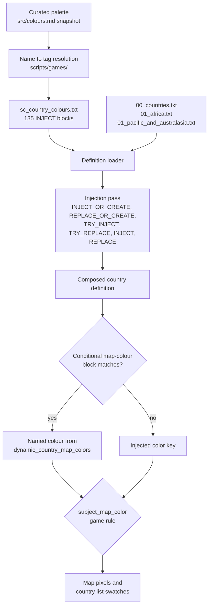
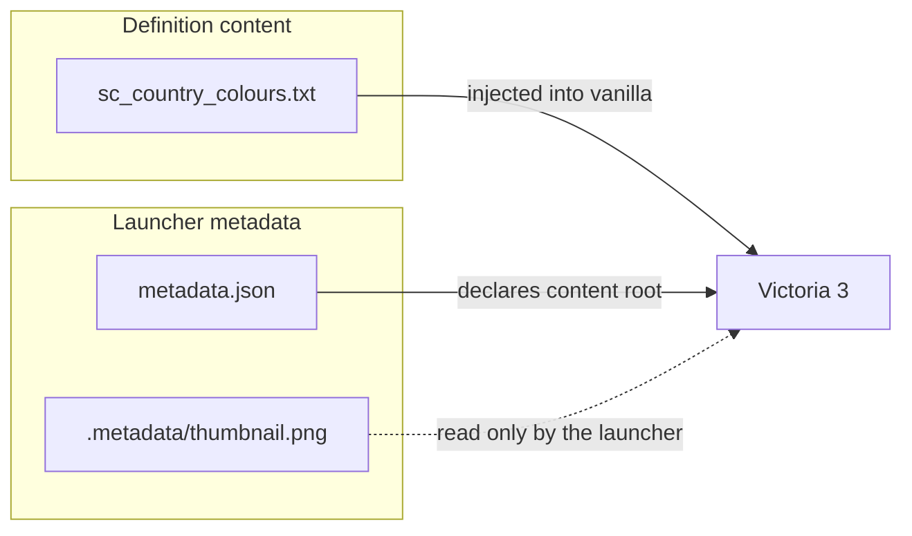
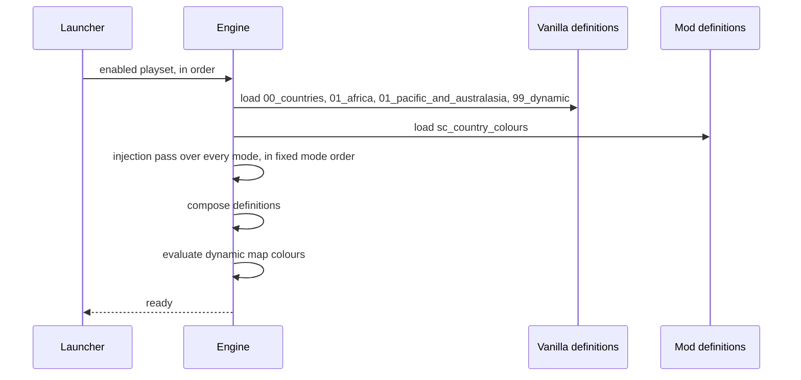

# Architecture

This document elaborates on the root [ARCHITECTURE.md](../ARCHITECTURE.md). It concentrates on the colour pipeline and the precedence layers that determine the colour a player actually sees. Read the root document first for the system context, component responsibilities, and design constraints.

## The pipeline in one view

## Precedence layers

Four layers can influence the colour, in this order of application. Later layers win.

| Layer | Source | Governs | Mod influence |
|-------|--------|---------|---------------|
| 1. Vanilla definition | `00_countries.txt`, `01_africa.txt`, `01_pacific_and_australasia.txt` | The default `color` of every tag | None |
| 2. Mod injection | `sc_country_colours.txt` | The `color` of the 135 mapped tags | Total |
| 3. Conditional map colour | `common/dynamic_country_map_colors/00_default.txt` | Runtime recolouring when a `possible` trigger matches | None |
| 4. Game rule | `common/game_rules/00_game_rules.txt` `subject_map_color` | Whether a subject inherits the overlord's colour | None |

Layer 2 beats layer 1 unconditionally, because the injection pass runs after every plain definition regardless of file name. Layer 3 beats layer 2 whenever its trigger holds, which is why a communist France does not show the Capet blue. Layer 4 is orthogonal: it decides whether the overlord's colour is projected onto a subject's territory.

## Why the injection pass is the right layer

Restating a whole country block would work, but it would silently pin every field of that country to whatever the author typed. When the game later changes a capital, a culture list, or a regnal number, the restated block would keep the stale value. The injection pass appends one key and leaves the other keys in the vanilla block, so the mod cannot drift.

The cost is that the mod cannot remove a vanilla key — it only adds or replaces the declared one — which is exactly the constraint the design wants.

## Relationship between the two artefacts

The launcher metadata does not describe the content; it only names the folder and declares compatibility. The content does not reference the metadata. They meet only inside the engine, which resolves the folder from the metadata and then reads every definition file it finds.

## The colour model

Victoria 3 accepts four syntaxes for a country `color`:

| Syntax | Example | Range |
|--------|---------|-------|
| Plain RGB block | `color = { 147 130 110 }` | 0–255 per component |
| `rgb` block | `color = rgb { 0.1 0.21 0.34 }` | 0–1 floats |
| `hsv` block | `color = hsv{ 0.99 0.7 0.9 }` | 0–1 floats |
| `hsv360` block | `color = hsv360{ 143 75 61 }` | hue 0–360, saturation and value 0–100 |
| Named colour string | `color = "kalmar_orange"` | key from `common/named_colors` |

Vanilla defines 735 `color` keys across 835 definition blocks: 718 use the plain RGB block, 11 use `hsv360`, and 6 use `hsv`. Seven of the mapped tags use a non-RGB form in vanilla — `BAH`, `BRZ`, `CAS`, `CEY`, `NET`, and `SPA` use `hsv360`, and `DEN` uses `hsv` — and the mod replaces each with a plain RGB block. Because the injected value replaces the whole `color` key rather than adding a second one, the syntax change is safe.

The mod ships only plain RGB blocks, so every shipped value has the same shape and a numeric audit is a simple range check.

## Where the mod sits in the engine's read order

File names matter for plain definitions — `00_countries.txt` loads before `01_africa.txt` — but not for injections, whose pass runs after all plain definitions have been read. See [flows/country-colour-injection.md](./flows/country-colour-injection.md).

## Divergence from the root document

The root [ARCHITECTURE.md](../ARCHITECTURE.md) states the same pipeline at system level. This document adds:

- the four-layer precedence model with the conditional map-colour layer made explicit;
- the vanilla colour-syntax census and the four tags whose syntax changes;
- the read-order sequence including `99_dynamic.txt`.

## Related documents

- [design-decisions.md](./design-decisions.md) — why these choices were made.
- [colour-mappings.md](./colour-mappings.md) — the shipped set.
- [behaviour/map-colour-conflicts.md](./behaviour/map-colour-conflicts.md) — layer 3 in practice.