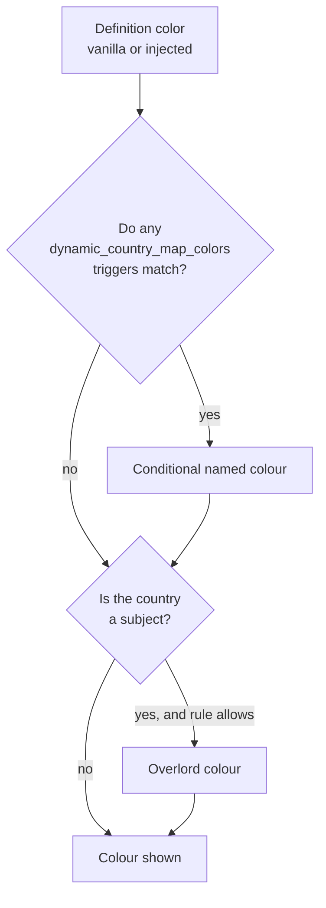

# Behaviour: map colour conflicts

The mod injects a definition colour, which is the lowest of the three colour sources the engine consults. This document describes when the injected value is not what the player sees.

## Layer interaction

## Conflict 1: conditional map colours

`common/dynamic_country_map_colors/00_default.txt` holds 104 blocks. Each names a trigger and a colour from `common/named_colors`. When a trigger matches, the block's colour replaces the definition colour for the remainder of the game, until the trigger stops matching.

**28 of the 131 mapped tags are referenced by at least one of these blocks.** The affected tags are:

`ALD`, `AUS`, `BHT`, `BRZ`, `BUL`, `CAM`, `CHI`, `FRA`, `GEO`, `GER`, `HND`, `HRE`, `JAP`, `KOR`, `KUK`, `MEX`, `NET`, `PAP`, `POR`, `RUS`, `SCA`, `SIC`, `SPA`, `SWE`, `TUR`, `UKR`, `USA`, `VEN`.

Examples of what a player sees instead of the standardised colour:

| Tag | Conditional block | Colour shown | Trigger character |
|-----|-------------------|--------------|-------------------|
| `FRA` | `republican_france` | `revolutionary_blue` | Republican government form |
| `FRA` | `commune_france` | `communist_france_red` | Communist law set |
| `GER` | `unpleasant_germany` | `feldgrau` | Specific political configuration |
| `GER` | `communist_germany` | `communist_germany_red` | Communist law set |
| `RUS` | 25 warlord blocks | Varied | Russian Civil War factions |
| `CHI` | `communist_china`, `republican_china`, `han_imperial_china` | Varied | Government form |
| `BHT` | `hindu_india`, `muslim_india`, `sikh_india` | Varied | State religion |
| `HRE` | 5 blocks | Varied | Government and ideology |

This is by design. A communist Germany showing red communicates more than a communist Germany showing the standardised grey. The mod does not ship `dynamic_country_map_colors`, so these blocks remain exactly as vanilla defines them.

**Diagnostic consequence.** "My colour did not apply" is usually "a conditional block is active". Check the country's government form and laws before suspecting the mod.

## Conflict 2: subjects

Victoria 3 has a game rule, `subject_map_color`, with two options:

| Option | Effect |
|--------|--------|
| `allow_subject_map_color` (default) | A subject may be drawn in its overlord's colour |
| `no_subject_map_color` | Subjects keep their own colour |

When subjugation is in force and the rule allows inheritance, the map shows the overlord's colour over the subject's territory. The subject's defined colour still governs its own list swatch and non-map appearances.

## Conflict 3: another mod defining the same country

Two cases, with different outcomes.

| Other mod's form | Outcome |
|------------------|---------|
| `INJECT:` or a plain definition | This mod's injection also applies; the later-loaded injection of the same key wins if both set `color` |
| `REPLACE:<tag>` | The whole block is replaced after the injection pass, so the other mod's colour wins even if this mod loads later |

`REPLACE:` beats `INJECT:` regardless of file name, because the mode order is fixed: `INJECT_OR_CREATE`, `REPLACE_OR_CREATE`, `TRY_INJECT`, `TRY_REPLACE`, `INJECT`, `REPLACE`. Where both mods use the same mode, the later file name wins.

## Conflict 4: unit colours

Unrelated to map colour, but frequently mistaken for it. Only seven vanilla tags define unit colours:

| Key | Effect |
|-----|--------|
| `primary_unit_color` | Main uniform tint |
| `secondary_unit_color` | Trim |
| `tertiary_unit_color` | Accent |

A mapped country whose soldiers look wrong is showing vanilla unit colours, which the mod never changes. Countries without these keys derive unit tinting from the coat of arms colours instead.

## Precedence summary

| Priority | Source | Controllable from this repository |
|----------|--------|-----------------------------------|
| Highest | Subject colour inheritance | No |
| High | Conditional map colour | No |
| Medium | `REPLACE:` from another mod | No |
| Base | Injection from this mod | Yes |
| Lowest | Vanilla definition | No |

## Related documents

- [flows/country-colour-injection.md](../flows/country-colour-injection.md) — the mechanism.
- [troubleshooting.md](../troubleshooting.md) — diagnosing a missing effect.