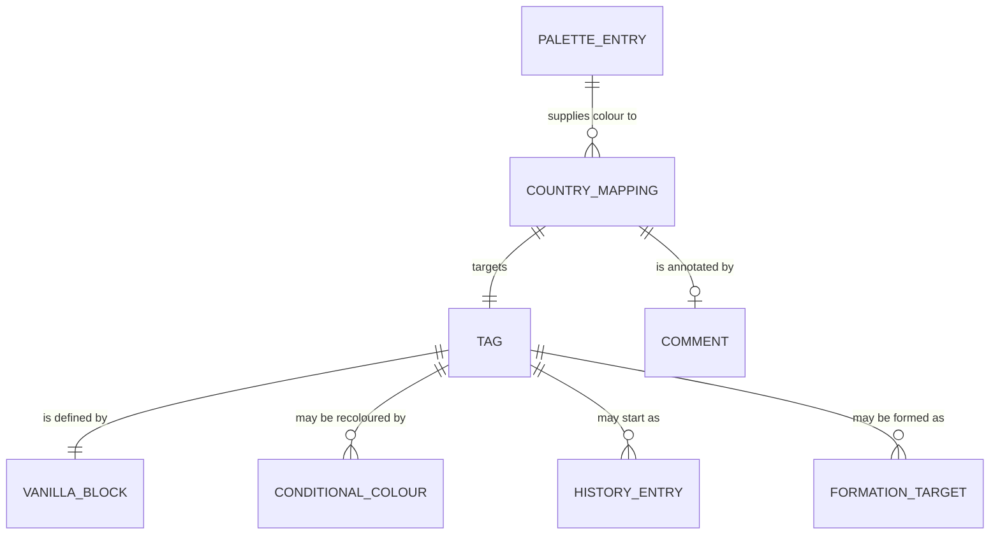

# Data model

## Entities

| Entity | Owner | Representation | Lifecycle |
|--------|-------|----------------|-----------|
| Palette entry | External document | Row in `COUNTRY_COLOURS.md` | Curated by hand; the snapshot in use is dated in [INDEX.md](./INDEX.md) |
| Country mapping | This repository | `INJECT:<tag>` block plus comment | Static; changes only with a commit |
| Tag | Game | Three-character key in `common/country_definitions` | Changes with a game patch |
| Vanilla block | Game | `<tag> = { ... }` with tier, cultures, capital, and so on | Changes with a game patch |
| Comment | This repository | `# <name> - <#HEX> - <source>` | Static |
| Conditional colour | Game | Block in `common/dynamic_country_map_colors/00_default.txt` | Changes with a game patch |
| History entry | Game | File in `common/history/countries/` | Decides whether the tag exists at the 1836 start |
| Formation target | Game | Block in `common/country_formation/` | Decides whether the tag can be formed |

## Country mapping

The atomic unit of the repository.

| Field | Type | Constraint | Source |
|-------|------|------------|--------|
| `tag` | 3-character key | Must exist in vanilla; unique in the file | Resolved from the palette entry name |
| `name` | Text | Should match the vanilla localised name | `countries_l_english.yml` |
| `paletteEntry` | Text or empty | Present only when it differs from `name` | Palette alias column |
| `hex` | `#RRGGBB` | Must equal the decimal triple | Palette primary column |
| `source` | Text | Attribution string | Palette source column |
| `rgb` | Three integers 0–255 | Derived from `hex` | Conversion |

## Derived relationships

For each mapping the repository can determine, from game evidence alone:

| Property | Derivation |
|----------|-----------|
| Exists at the 1836 start | Presence of `common/history/countries/<tag> - <name>.txt` |
| Is a formation target | Presence of a `<tag> = {` block in `common/country_formation/` |
| Has a conditional map colour | Presence of the tag in any `possible` trigger under `common/dynamic_country_map_colors/` |
| Vanilla colour and its syntax | The `color` key in the vanilla block |

Current distribution:

| Property | Count |
|----------|-------|
| Start-date | 40 |
| Formation target | 32 |
| Both | 10 |
| Neither | 27 |

## Palette-to-tag cardinality

| Cardinality | Cases |
|-------------|-------|
| One palette entry to one tag | 87 |
| One palette entry to two tags | 2 — India (`BHT`, `HND`) and Romania (`ROM`, `WAL`) |
| No tag | Every remaining palette row |

## State

The repository owns no persistent state. The engine's composed definition is in-memory and rebuilt on every load; a country released or formed during play composes a fresh definition, which is why the injected colour applies to it.

## Related documents

- [colour-mappings.md](./colour-mappings.md) — the instantiated data.
- [state-and-persistence.md](./state-and-persistence.md) — why state is absent.
- [components/mod-content.md](./components/mod-content.md) — the file shape.