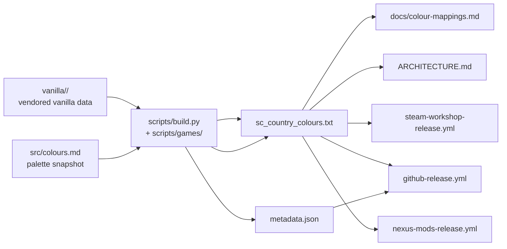

# Dependencies

## Runtime dependencies

| Dependency | Version | Responsibility | Consequence of change |
|------------|---------|----------------|-----------------------|
| Victoria 3 | `1.15.*` | Parses the metadata, loads country definitions, runs the injection pass, resolves map colours | A patch can retire or rename a tag, which makes the matching injection error |
| Vanilla `common/country_definitions` | shipped with the game | Supplies the 835 baseline blocks the mod targets | A changed tag set invalidates the affected entries |
| Vanilla `common/named_colors` | shipped with the game | Resolves the named colours used by conditional map-colour blocks | A renamed colour changes a conditional appearance, not the mod's own values |

## Authoring dependencies

| Dependency | Responsibility | Consequence |
|------------|----------------|-------------|
| `src/colours.md` palette snapshot | Source of every standardised value and its attribution | The build derives the values from it; the repository records the snapshot |
| `vanilla/imperator/` snapshot | Source of the vanilla index and country files the Imperator build preserves | Committed, so the build needs no game installation; a stale snapshot makes the output diverge from the shipped game |
| Hex-to-decimal conversion | Converts `#RRGGBB` to three 0–255 components | Performed by `scripts/build.py`, so a wrong conversion is a build defect rather than a silent mis-colour |
| Tag resolution | Maps a palette entry name to a three-letter tag | Hardcoded in the game edition's `config.py`; a wrong tag colours the wrong country and is immediately visible |

## Development dependencies

None beyond the Python 3 standard library. Editing the mod means editing the palette snapshot or the build configuration and rerunning `scripts/build.py`. No SDK, package manager, third-party runtime, compiler, or test framework is required.

## Tooling dependencies

| Tool | Used by | Optional |
|------|---------|----------|
| `python3` | `scripts/build.py` and the verification snippets in [testing.md](./testing.md) | No, for building |
| `zip` | Release workflow | No, for releases |
| `rsvg-convert` | Regenerating the source artwork | Yes, only when the artwork changes |
| Victoria 3 with `-debug_mode` | In-game verification | Yes, but required for behavioural checks |

## Internal dependencies between documents and content

Documentation depends on content; content is rendered by the build from the palette snapshot, the vendored vanilla data, and the hardcoded mappings. No document is read by the engine.

## Supply chain assessment

The repository has no packages, lockfiles, SBOM, or third-party code. The only executable elements are:

1. `scripts/build.py`, which uses only the Python 3 standard library and runs on the maintainer's machine;
2. a GitHub Action (`actions/checkout@v7`, `softprops/action-gh-release@v2`), pinned to major versions;
3. `hmlendea/steam-workshop-update@latest`, which publishes to the Workshop item;
4. `Nexus-Mods/upload-action@v1.0.0-beta.11`, which publishes to Nexus Mods;
5. the `zip` command from the runner image.

Apart from the build script, all run only in the release workflows, never on a player's machine. The Workshop workflow additionally reads the `STEAM_USERNAME`, `STEAM_PASSWORD`, and `STEAM_2FA_SEED` repository secrets and the Nexus Mods workflow reads `NEXUSMODS_API_KEY`; their values are never printed and never leave the runner except to the respective service.

## Related documents

- [integrations.md](./integrations.md) — the external systems these dependencies represent.
- [security.md](./security.md) — the trust boundary.