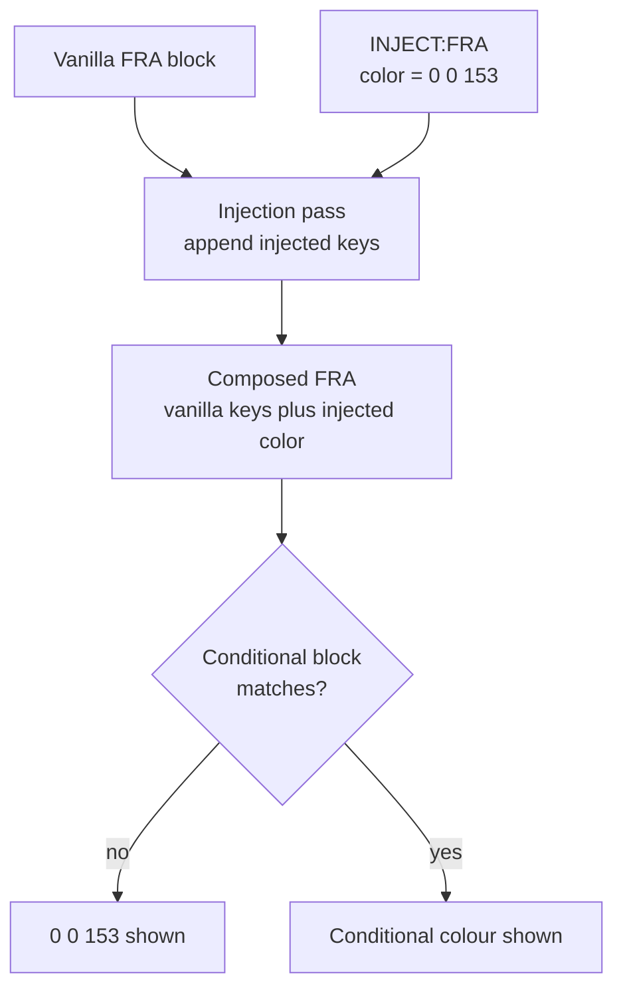

# Flow: country colour injection

This flow details the definition-injection pass, which is the entire mechanism by which the mod takes effect.

## The mode table

Victoria 3 recognises six prefixes on a top-level definition block. They are not interchangeable.

| Mode | Behaviour | Errors when the target is absent |
|------|-----------|----------------------------------|
| `INJECT:` | Appends the declared keys to the existing block | Yes |
| `REPLACE:` | Replaces the existing block wholesale | Yes |
| `TRY_INJECT:` | As `INJECT:`, silently skipped when absent | No |
| `TRY_REPLACE:` | As `REPLACE:`, silently skipped when absent | No |
| `INJECT_OR_CREATE:` | As `INJECT:`, creating the block when absent | No |
| `REPLACE_OR_CREATE:` | As `REPLACE:`, creating the block when absent | No |

The mod uses `INJECT:` exclusively. That is the strictest form: it cannot silently create a country, and it fails loudly if a tag is retired by a game patch, which is the desired behaviour for a curated mapping.

## Processing order

The pass runs in a fixed order that ignores file names:

```text
INJECT_OR_CREATE
-> REPLACE_OR_CREATE
-> TRY_INJECT
-> TRY_REPLACE
-> INJECT
-> REPLACE
```

Three consequences matter:

1. A `REPLACE:` in any mod beats the mod's `INJECT:`, no matter which loads later.
2. An `INJECT:` beats every plain definition, because the pass runs after all of them.
3. Where two blocks use the same mode on the same tag, the later file name wins.

## What the pass does with one entry

Input:

```text
INJECT:FRA = {
	color = { 0 0 153 }
}
```

Vanilla block:

```text
FRA = {
	color = { 20 50 210 }
	country_type = recognized
	tier = empire
	cultures = { french }
	capital = STATE_ILE_DE_FRANCE
	regnal_numbers = { ... }
	primary_unit_color = { ... }
}
```

Result, conceptually:

```text
FRA = {
	color = { 0 0 153 }          # injected; replaces the vanilla value
	country_type = recognized
	tier = empire
	cultures = { french }
	capital = STATE_ILE_DE_FRANCE
	regnal_numbers = { ... }
	primary_unit_color = { ... }
}
```

The engine appends the injected key to the block. Because a scalar key cannot occur twice in one block, the injected `color` wins and no duplicate exists.



## Sub-block limitation

`INJECT:` cannot reach into a nested block. It only adds or replaces keys at the top level of the target block. For a country definition this is exactly what is needed: `color` is a top-level scalar. A key such as `regnal_numbers`, which is itself a block, would be appended as a second copy rather than merged, which is another reason the mod touches only `color`.

## Why a target must exist

An `INJECT:` whose target is absent errors. The palette covers titles Victoria 3 does not model, so those entries cannot be shipped at all: there is nothing to inject into. Every shipped tag was resolved against the installed vanilla definitions, and 101 of the palette's titles survived that check.

## Idempotence

Running the pass twice over the same tag yields the same result, because the last-applied `color` wins and the injected value is constant. Reloading the mod, restarting the game, or releasing and re-forming a country therefore all converge on the same colour.

## Evidence

- The six modes and their semantics are documented by the Victoria 3 modding community and appear as literal strings in the game binary, including the error text `You are trying to inject/replace to a non-existing entry: {}:{} in the file {}:{}`.
- `common/country_definitions` is on the enumerated list of folders that accept the modes.
- The vanilla content uses none of the keywords, so no first-party example exists to copy.

## Related documents

- [behaviour/map-colour-conflicts.md](../behaviour/map-colour-conflicts.md) — what happens afterwards.
- [components/mod-content.md](../components/mod-content.md) — the shipped entries.
- [flows/colour-authoring.md](./colour-authoring.md) — adding an entry.