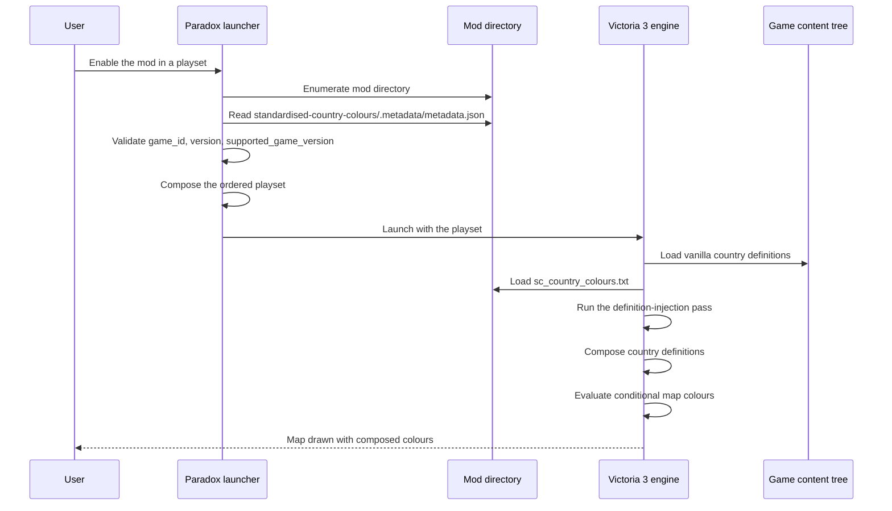

# Flow: mod discovery and load

This flow covers what happens from the moment the launcher starts to the moment a country has a final colour.

## Sequence

## Step detail

### 1. Discovery

The launcher enumerates the mod directory. A folder is a candidate mod only when it contains `.metadata/metadata.json`. A folder holding `common/country_definitions/` but no `.metadata/` is invisible.

### 2. Validation

The launcher reads and validates the JSON. Relevant checks:

| Check | Failure result |
|-------|----------------|
| Valid JSON | The mod is not listed |
| `game_id` equals `victoria3` | The mod may be listed for the wrong game or not at all |
| `supported_game_version` covers the installed build | The mod is listed as outdated |
| `picture` resolves to a file beside the JSON | The mod is listed without artwork |

### 3. Playset composition

The user's selected mods form an ordered playset. Order affects only files that use the same override mode; the injection pass itself runs after every plain definition regardless of order.

### 4. Vanilla load

The engine reads `00_countries.txt`, `01_africa.txt`, `01_pacific_and_australasia.txt`, and `99_dynamic.txt` in that order. The first three are sets of plain country blocks. `99_dynamic.txt` holds 99 placeholder definitions (`D01`–`D99`), each marked `dynamic_country_definition = yes`; none of them carries a colour, and the mod never targets one.

### 5. Mod load

The engine reads `sc_country_colours.txt`. Every block is prefixed with `INJECT:`, so it is not applied as a plain definition but queued for the injection pass.

### 6. Injection pass

The pass runs in a fixed mode order — `INJECT_OR_CREATE`, `REPLACE_OR_CREATE`, `TRY_INJECT`, `TRY_REPLACE`, `INJECT`, `REPLACE` — after all plain definitions from every source. `INJECT:<tag>` appends the declared keys to the existing block named `<tag>`.

An injection whose target does not exist errors and is skipped. That is why every shipped tag is validated against the vanilla set before release.

### 7. Composition

The engine composes each country definition from the merged block. The composed definition, not the file contents, is what the rest of the game reads.

### 8. Conditional colour evaluation

For each composed definition, the engine evaluates the `possible` trigger of every block in `common/dynamic_country_map_colors/00_default.txt`. The first matching block, or the highest-priority match, replaces the definition colour. See [behaviour/map-colour-conflicts.md](../behaviour/map-colour-conflicts.md).

### 9. Rendering

The final colour is used for the map fill, the country list swatch, and diplomacy identifiers.

## Re-evaluation triggers

The conditional evaluation is not continuous. The vanilla file's own header notes that its triggers are checked "at certain key points in the code, not all the time". The definition colour itself is re-read when a country is released or formed, because the engine composes a fresh definition at that moment.

## Failure visibility

| Failure | Surface |
|---------|---------|
| Mod not listed | Launcher |
| Metadata invalid | Launcher |
| Injection target missing | `<user data>/Victoria 3/logs/error.log` |
| No byte-order mark | `<user data>/Victoria 3/logs/error.log` |
| Wrong colour applied | Visible on the map, no log entry |

## Related documents

- [flows/country-colour-injection.md](./country-colour-injection.md) — step 6 in detail.
- [logging.md](../logging.md) — the log surfaces.