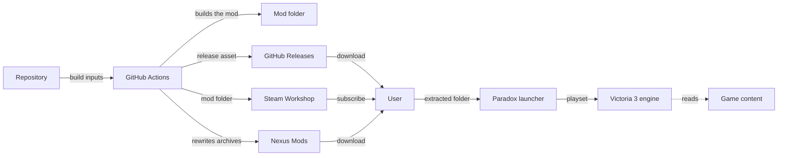

# Integrations

## Integration map

| Integration | Direction | Contract | Required |
|-------------|-----------|----------|----------|
| Victoria 3 engine | Inbound | Definition file format, six injection modes, encoding rules | Yes |
| Paradox launcher | Inbound | `.metadata/metadata.json` schema | Yes |
| Vanilla content tree | Inbound | Tag set and baseline blocks | Yes |
| GitHub Actions | Outbound | Workflow YAML, `contents: write` | For releases only |
| GitHub Releases | Outbound | Asset name and archive layout | For distribution only |
| Steam Workshop | Outbound | Workshop item id, uploaded mod content | For Workshop distribution only |
| Nexus Mods | Outbound | Nexus Mods file id and uploaded archive | For Nexus Mods distribution only |

## Victoria 3 engine

The engine is the only consumer of the content. Contract details:

| Contract | Invariant |
|----------|-----------|
| File location | `common/country_definitions/` inside the mod folder |
| Encoding | UTF-8 with a byte-order mark |
| Entry form | `INJECT:<tag> = { <keys> }` at top level |
| Colour form | `color = { R G B }`, integers 0–255 |
| Injection target | Must exist, or the entry errors and is skipped |

## Paradox launcher

The launcher validates the metadata and composes the playset. It never reads the content.

| Contract | Invariant |
|----------|-----------|
| Metadata location | `.metadata/metadata.json` at the mod folder root |
| Format | Valid JSON with no comments |
| Game association | `game_id` equals `victoria3` |
| Artwork | `picture` resolves beside the JSON |

## Vanilla content

The tag set and the baseline blocks are inputs, not dependencies the repository controls. A patch that retires a tag invalidates the matching entry, and an injection into a missing tag errors. This is why [invariants.md](./invariants.md) requires a review per game patch.

## GitHub Actions and Releases

The workflow's only interaction with the repository is reading the tagged tree. It builds both game editions at the tag's version and attaches one archive per edition to the release.

| Contract | Invariant |
|----------|-----------|
| Trigger | Published release, or manual dispatch with a tag |
| Version | Derived from the tag with the leading `v` removed, and passed to `scripts/build.py` |
| Build | `python3 scripts/build.py --game victoria3 --version "${{ steps.version.outputs.version }}"` and, in a separate step, `--game imperator`, each archived in its own step |
| Archive name | `standardised-country-colours_<game>_<version>.zip` |
| Archive root | The mod folder, not its contents |
| Permissions | `contents: write` |

## Steam Workshop

Integrated through `.github/workflows/steam-workshop-release.yml`. The workflow builds the mod and uploads the mod folder to the matching Workshop item in serial jobs: `3845820843` for Steam app `394360` (Hearts of Iron IV), `3844790373` for Steam app `529340` (Victoria 3), and `3845414842` for Steam app `859580` (Imperator: Rome), through `hmlendea/steam-workshop-update@latest`. Serial execution prevents concurrent Steam Guard logins for the shared publishing account.

| Contract | Invariant |
|----------|-----------|
| Trigger | `v*.*.*` tag push, or manual dispatch with a tag |
| Version | The pushed or supplied tag, referenced directly as `${{ env.VERSION }}` |
| Upload root | `release-vic3/standardised-country-colours/` (Victoria 3) and `release-imperator/standardised-country-colours/` (Imperator: Rome), the extracted mod folder |
| Preview image | `icon` names `release-<game>/standardised-country-colours/thumbnail.png`, set as the descriptor's `previewfile` |
| Secrets | `STEAM_USERNAME`, `STEAM_PASSWORD`, and `STEAM_2FA_SEED`, read from repository secrets and never exposed |
| Changenote | A link to the GitHub release of the same tag |

## Nexus Mods

Integrated through `.github/workflows/nexus-mods-release.yml`. The workflow builds and archives each edition, then uploads it to Nexus Mods file `8459265` (Hearts of Iron IV), `8446233` (Victoria 3), and `8454045` (Imperator: Rome) through `Nexus-Mods/upload-action@v1.0.0-beta.11`.

| Contract | Invariant |
|----------|-----------|
| Trigger | `v*.*.*` tag push, or manual dispatch with a tag |
| Version | The pushed or supplied tag, referenced directly as `${{ env.VERSION }}` |
| Archive | `release-vic3.zip` or `release-imperator.zip` wrapping the mod folder, published as `standardised-country-colours-<game>.zip` |
| Secret | `NEXUSMODS_API_KEY`, read from repository secrets and never exposed |
| Description | A link to the GitHub release of the same tag |

## Related documents

- [components/packaging-and-distribution.md](./components/packaging-and-distribution.md) — the release pipeline.
- [dependencies.md](./dependencies.md) — version constraints.
- [security.md](./security.md) — trust boundaries across these integrations.