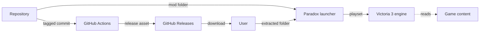

# Integrations

## Integration map

| Integration | Direction | Contract | Required |
|-------------|-----------|----------|----------|
| Victoria 3 engine | Inbound | Definition file format, six injection modes, encoding rules | Yes |
| Paradox launcher | Inbound | `.metadata/metadata.json` schema | Yes |
| Vanilla content tree | Inbound | Tag set and baseline blocks | Yes |
| GitHub Actions | Outbound | Workflow YAML, `contents: write` | For releases only |
| GitHub Releases | Outbound | Asset name and archive layout | For distribution only |
| Steam Workshop | None | Not used; the mod is not uploaded there | No |
| Paradox Mods | None | Not used | No |
| Nexus Mods | None | Not used | No |

## Victoria 3 engine

The engine is the only consumer of the content. Contract details:

| Contract | Invariant |
|----------|-----------|
| File location | `common/country_definitions/` inside the mod folder |
| Encoding | UTF-8 with a byte-order mark |
| Entry form | `INJECT:<tag> = { <keys> }` at top level |
| Colour form | `color = { R G B }`, integers 0–255 |
| Injection target | Must exist, or the entry errors and is skipped |

## Paradox launcher

The launcher validates the metadata and composes the playset. It never reads the content.

| Contract | Invariant |
|----------|-----------|
| Metadata location | `.metadata/metadata.json` at the mod folder root |
| Format | Valid JSON with no comments |
| Game association | `game_id` equals `victoria3` |
| Artwork | `picture` resolves beside the JSON |

## Vanilla content

The tag set and the baseline blocks are inputs, not dependencies the repository controls. A patch that retires a tag invalidates the matching entry, and an injection into a missing tag errors. This is why [invariants.md](./invariants.md) requires a review per game patch.

## GitHub Actions and Releases

The workflow's only interaction with the repository is reading the tagged tree. Its only output is an archive attached to the release.

| Contract | Invariant |
|----------|-----------|
| Trigger | Published release, or manual dispatch with a tag |
| Version | Derived from the tag with the leading `v` removed |
| Archive name | `standardised-country-colours_<version>.zip` |
| Archive root | The mod folder, not its contents |
| Permissions | `contents: write` |

## Steam Workshop

Not integrated. No `steam-workshop-release.yml` exists, no Workshop item id is configured, and no secrets are stored. Adding Workshop publication would require a manuscript workflow, `STEAM_USERNAME`, `STEAM_PASSWORD`, and `STEAM_2FA_SEED` secrets, and an item id; none is present.

## Related documents

- [components/packaging-and-distribution.md](./components/packaging-and-distribution.md) — the release pipeline.
- [dependencies.md](./dependencies.md) — version constraints.
- [security.md](./security.md) — trust boundaries across these integrations.