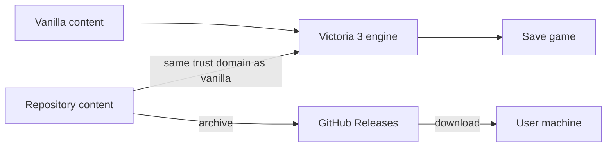

# Security

This document elaborates on the root [SECURITY.md](../SECURITY.md). That document is authoritative for reporting and scope; this one describes the trust model and the practical risks of the shipped content.

## Trust model

The mod ships plain text that the engine parses within the same trust domain as vanilla content. There is no sandbox boundary between a mod definition file and a base-game definition file: a mod file can change what the game loads, but it cannot execute code, open sockets, or read arbitrary files.

## Attack surfaces

| Surface | Exposure | Mitigation |
|---------|----------|------------|
| Definitions text | Parsed by the engine | Content is a fixed set of integer colours; a tampered file could at worst change colours or inject other country keys |
| Launcher metadata | Parsed by the launcher | JSON only; a tampered file could misdescribe the mod |
| Thumbnails | Decoded by the launcher and Steam | PNG decode; a malicious image exploits the decoder, not the mod |
| Release workflow | Runs `actions/checkout@v7`, `softprops/action-gh-release@v2`, and `zip` | Pinned to major versions; `contents: write` is the only scope |
| Distribution channel | GitHub Releases | HTTPS; no signature is published |

## What a malicious fork could do

A fork can change any byte. The realistic consequences are limited to the content surface:

| Change | Consequence |
|--------|-------------|
| Alter colours | Cosmetic |
| Add `INJECT:` keys beyond `color` | Can change tier, cultures, or capital of a country — a gameplay change, not a system compromise |
| Use `REPLACE:` | Discards a vanilla block entirely, which can break a country |
| Add a definition file named after a vanilla file | Deletes vanilla content |
| Add a non-colour folder | Could inject events, effects, or scripted rules, which is where gameplay risk concentrates |

The last row matters: the repository ships only `common/country_definitions/`, and that is what a user should verify in an archive. A release from this repository never contains events, effects, or scripted rules.

## Verification a user can perform

1. Inspect the archive listing: it should contain exactly `.metadata/`, `common/country_definitions/sc_country_colours.txt`, and `thumbnail.png` inside the mod folder.
2. Confirm the definition file contains only `INJECT:` blocks with a single `color` key each.
3. Confirm no other content folders are present.

## Secrets

None. The repository stores no credentials, tokens, or keys. The release workflow uses the automatic `GITHUB_TOKEN`.

## Supply chain

No packages, no lockfiles, no build-time dependencies to compromise. The only third-party code executes on GitHub's runners.

## Content-integrity risks specific to this mod

| Risk | Consequence | Control |
|------|-------------|---------|
| A retired tag is left in the file | An injection errors on every load | Review the tag set per game patch |
| A tag is mapped to the wrong country | Silent, persistent mis-colour | Comment records the name; review against the localisation |
| `REPLACE:` is introduced by accident | A vanilla block is destroyed | Invariant C1 |
| A vanilla file name is reused | Vanilla definitions are destroyed | Invariant D3 |

## Privacy

The mod handles no personal data. See [PRIVACY.md](../PRIVACY.md).

## Related documents

- [dependencies.md](./dependencies.md) — supply chain detail.
- [integrations.md](./integrations.md) — trust boundaries per integration.
- [invariants.md](./invariants.md) — the guard conditions.