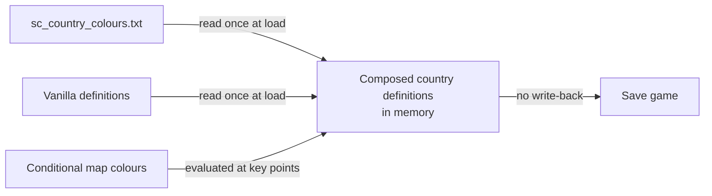

# State and persistence

## Repository state

None. The repository owns no database, cache, queue, or session. The build writes a transient `out/` directory that is ignored by version control and reproduces the committed folder exactly, so no generated artefact is tracked. Every tracked file is either a build input or a static input to the game.

## Where state actually lives

| State | Owner | Lifetime | Persisted |
|-------|-------|----------|-----------|
| Composed country definition | Engine | Process lifetime; recomposed on release or formation | No |
| Active conditional colour | Engine | Until the trigger stops matching | Indirectly, through the government and laws stored in the save |
| Colour shown on the map | Engine | Recomputed on each draw | No |
| Save game | Engine | User-controlled | Yes, and it records laws and government rather than colours |

## What a save game contains

A save records the country's government form, laws, and territory. It does not record the map colour, because the colour is derived from content on load. Consequently:

- enabling the mod changes the colours of an existing save without migrating anything;
- disabling the mod reverts the colours;
- a save shared between players shows different colours if their mod sets differ, because each client derives the colour from its own content.

The one indirect coupling is the conditional map-colour layer: a save whose Germany has adopted a communist law set will trigger `communist_germany` on any client, regardless of this mod.

## Persistence the repository does not perform

| Facility | Present |
|---------|---------|
| Database | No |
| Migrations | No |
| Cache | No |
| Generated artefact committed to the repository | No; `out/` is ignored and reproduces the committed folder |
| Configuration state | No |

## Why there is nothing to migrate

The content is a lookup from tag to colour. Adding, changing, or removing a row has no historical dimension: a loaded save simply composes definitions again from the current content. There are therefore no migration scripts, no version-gated branches, and no compatibility shims.

## Release-to-release equivalence

Two releases that differ only in colour values produce saves that load in either direction without conversion, because the save stores no colour and the game defines no colour-dependent state.

## Related documents

- [data-model.md](./data-model.md) — the entities.
- [components/mod-content.md](./components/mod-content.md) — the static input.
- [configuration.md](./configuration.md) — the only setting surface.